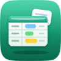
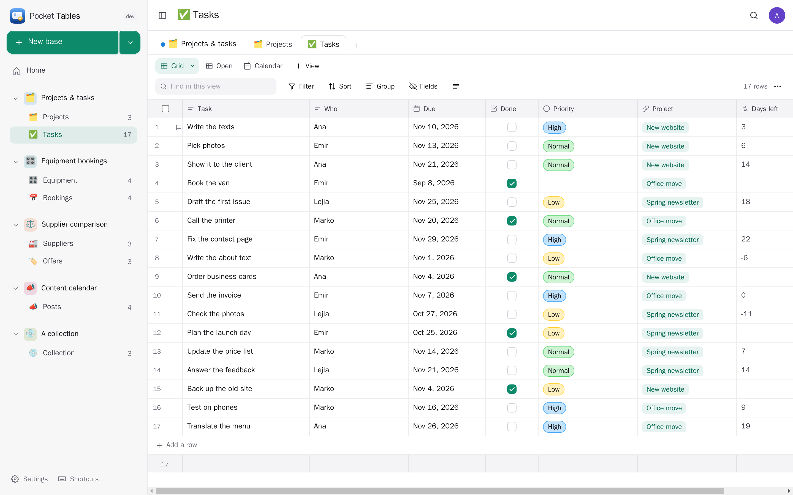
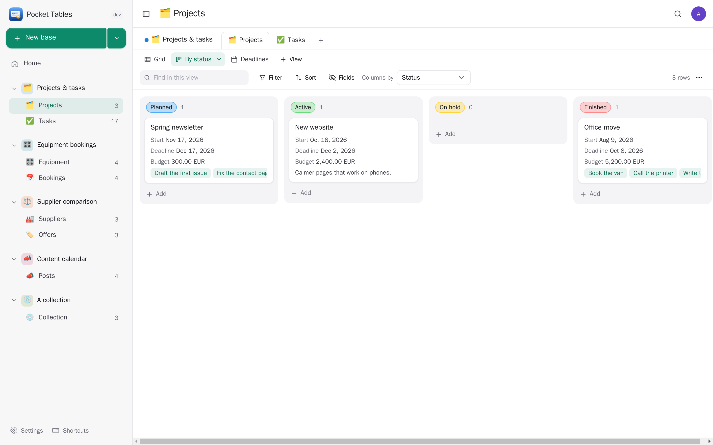
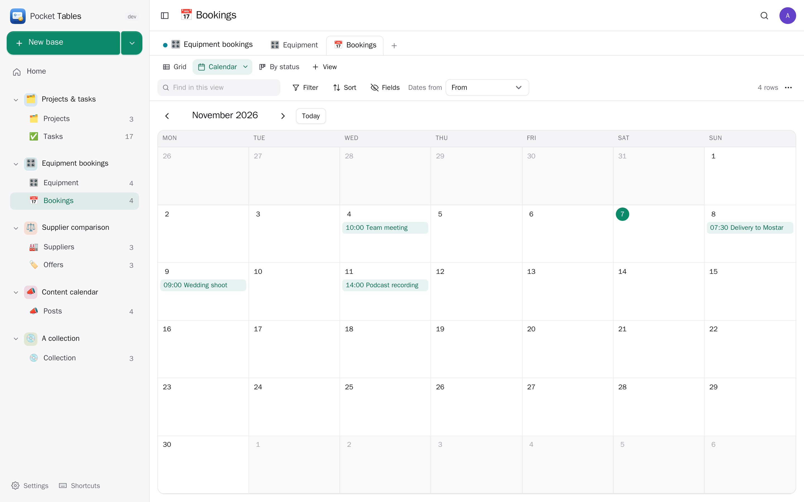
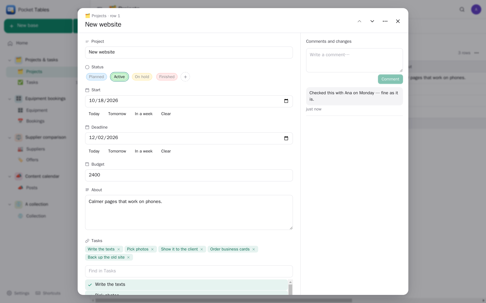
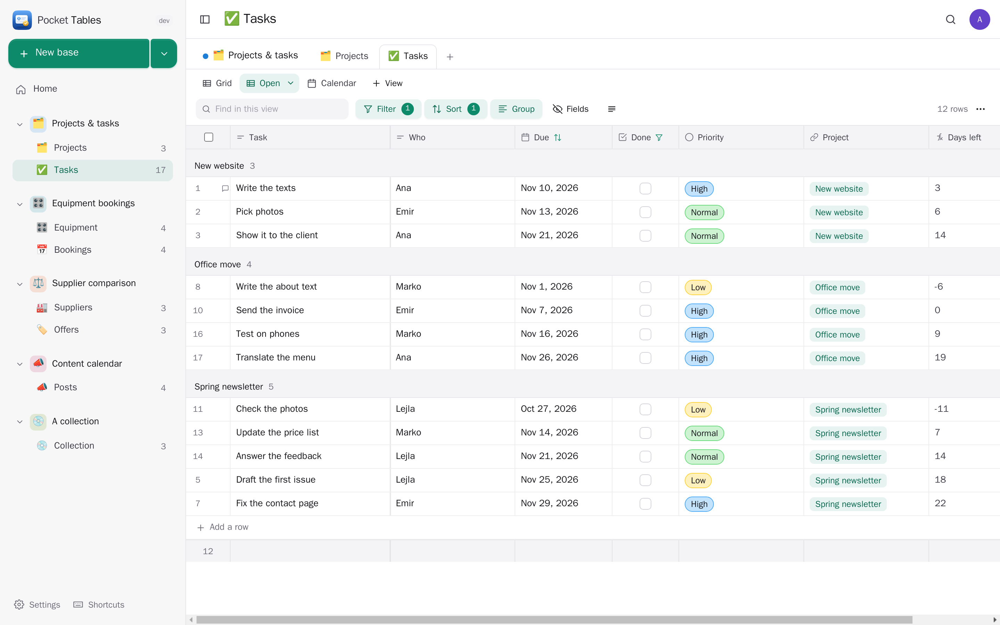
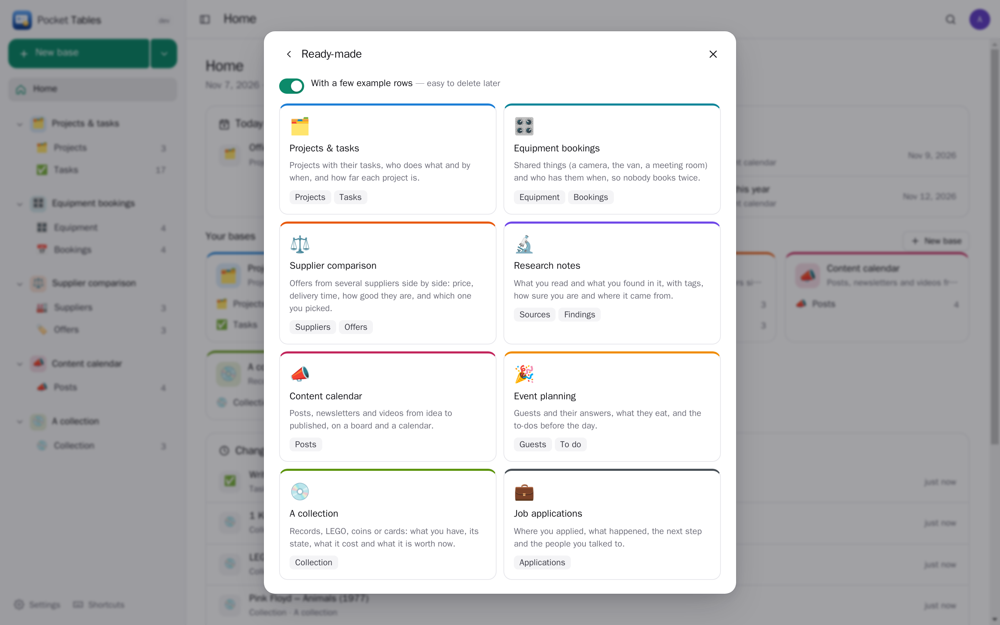
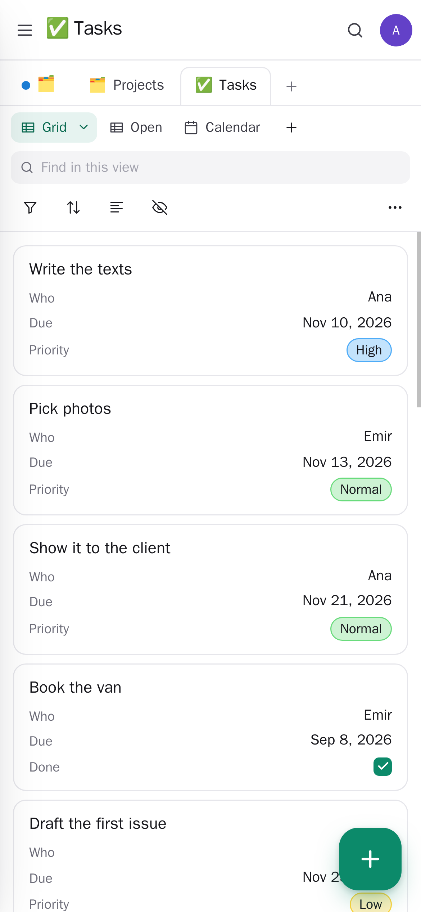
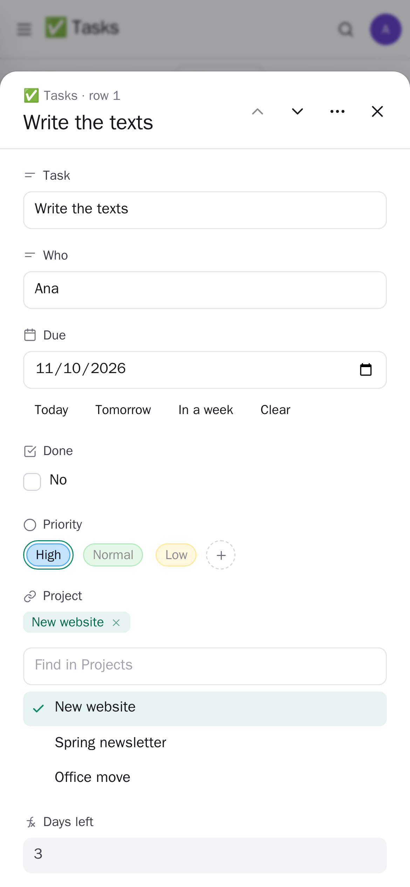

<p align="center"></p>
<h1 align="center">Pocket Tables</h1>
<p align="center">Your own small databases, without code — like Airtable on your own server. Tables with fields that know what they hold (choices, dates, money, ratings, files, links to other tables, look-ups, totals and formulas), seen as a grid, a board, a calendar or a gallery, with filters, sorts and groups you keep per view. A row can point at a contact, task, event, note, place, book or payment in your other Pocket apps; a table keeps its dates in your calendar and takes the answers to a form as new rows. Start from a ready-made base, a spreadsheet, your other apps, or by describing it to AI.<br>One Go binary, one SQLite file, one volume. Part of the Pocket apps; works on its own too.</p>
<p align="center">
  <a href="https://github.com/abjelosevic88/pocket-homelab-tables/actions"></a>
  <a href="https://github.com/abjelosevic88/pocket-homelab-tables/pkgs/container/pocket-homelab-tables"></a>
  <a href="LICENSE"></a>
</p>

---

<p align="center"></p>

<table>
  <tr>
    <td width="50%"></td>
    <td width="50%"></td>
  </tr>
  <tr>
    <td align="center"><sub>A board: cards in columns by a choice field; drag them across.</sub></td>
    <td align="center"><sub>A calendar: each row on the day of a date field; drag to move it.</sub></td>
  </tr>
  <tr>
    <td width="50%"></td>
    <td width="50%"></td>
  </tr>
  <tr>
    <td align="center"><sub>A row: every field, its comments and changes, and what it has in your other apps.</sub></td>
    <td align="center"><sub>A view with a filter, a sort and groups — each view keeps its own.</sub></td>
  </tr>
  <tr>
    <td width="50%"></td>
    <td width="50%"> </td>
  </tr>
  <tr>
    <td align="center"><sub>Ready-made bases to start from.</sub></td>
    <td align="center"><sub>On a phone: rows as cards, a row as a sheet.</sub></td>
  </tr>
</table>

## What it does

- **Bases and tables** you shape yourself: 22 field types — text, long text, number, money, percent, rating, yes/no, date (with a time, with a reminder), choice and several choices (coloured), email, phone, web link, files, **links between tables** (both sides kept), **look-ups** and **totals** of the linked rows, **formulas** (`{Price} * {Quantity}`, `IF`, `DAYS`, `DATEADD`, `CONCAT` and 50 more), row numbers, added and changed times.
- **Four ways to look**: a grid (a real spreadsheet: arrows, Enter, typing, copy, and **paste a block from Excel** — new rows are added), a board, a calendar and a gallery. Each view keeps its own filters (all/any), sorts, groups, hidden and ordered fields, column widths, row height and totals under the columns.
- **A row** opens as a sheet: every field, comments, every change (who, what, before and after), and its tasks, events and notes in your other apps. Deleted rows wait 30 days in the bin.
- **Start any way**: blank, eight ready-made bases (projects, equipment bookings, supplier comparison, research, content calendar, event, a collection, job applications), a spreadsheet (CSV/TSV from Excel, Google Sheets, Numbers or **Airtable** — field types are guessed), a list from your other Pocket apps, a file in Pocket Files, a table or query in one of your databases, or **describe it and AI sets it up** (you see it before anything is made).
- **AI** (optional, only when you ask): design tables, **fill a column** for many rows at once (sort into options, sum up, guess), and **ask a question** about a table.
- **Reminders**: date fields with “remind me” show on Home and in a morning message (Apprise, ntfy or a webhook).
- **Everyone their own** on one box; admins see no one else's tables. Export everything as JSON (and back), each table as CSV.

## Run it

```sh
docker run -d --name pocket-tables -p 8080:8080 -v ./data:/data \
  -e BASE_URL=https://tables.example.com -e SECURE_COOKIES=true \
  ghcr.io/abjelosevic88/pocket-homelab-tables:latest
```

or `docker compose up -d` with [docker-compose.yml](docker-compose.yml). Open it, create the first account and start a base. All options: [docs/configuration.md](docs/configuration.md). API: [docs/api.md](docs/api.md).

## With Pocket Core

Set `CORE_URL` and `CORE_REGISTRATION_KEY` and Tables joins the box: people sign in with Pocket Core, Pocket AI helps, and through app links your tables reach your own Pocket apps with nothing to paste:

| App | In a table | Scopes |
|---|---|---|
| Pocket Calendar | keep a table's dates as events (changed and removed with the rows); put one row on the calendar; point a row at an event | `calendar:read`, `calendar:write` |
| Pocket Tasks | make a task from a row, due on its date; tick a field when the task is done; point a row at a task | `tasks:read`, `tasks:write` |
| Pocket Forms | tie a form to a table: each answer becomes a row by itself; make a form from a table's fields | `forms:read`, `forms:write` |
| Pocket Notes | save a row or a whole table as a note; point a row at a note | `notes:read`, `notes:write` |
| Pocket Files | save a table as a spreadsheet; make a table from a spreadsheet there | `files:read`, `files:write` |
| Pocket Database | make a table from a table or a read-only query in your Postgres, MySQL or SQLite databases; bring in the latest rows (matched by the primary key) — the database is never changed | `databases:read`, `databases:query` |
| Pocket Contacts, Inventory, Places, CRM, Bookshelf, Wishlist, Money | point a row at a person, a thing, a place, a deal, a book, a wish or a payment; make a table from them | `contacts:read`, `items:read`, `places:read`, `crm:read`, `books:read`, `wishes:read`, `transactions:read` |
| Pocket Documents | point a row at a scanned document | `documents:read` |

**Nothing depends on another app.** Each app's state is checked per person — connected, switched off here, switched off in Pocket Core, not on this box, too old — and what needs it is shown greyed out with one line saying why and what to do, never hidden.

Other apps use your tables through `tables:read` and `tables:write`: Pocket Search finds rows, Pocket Day shows the rows with a date on the day, Pocket AI answers questions about your tables and adds rows, and Pocket Flows can add a row as a step. Events on the bus — `tables.record_created`, `tables.record_updated`, `tables.record_deleted`, `tables.reminder` — start flows in Pocket Flows. Without Core every connection can be made directly with a URL and a token; the Core-only choices stay visible, greyed out.

## Develop

```sh
make dev     # API on :8080 with demo data + Vite on :5173
make test    # go vet, go test, tsc
make         # web + binary
```

`node scripts/screenshots.mjs` takes the screenshots above from a demo instance and fails on any browser error. MIT licensed.
